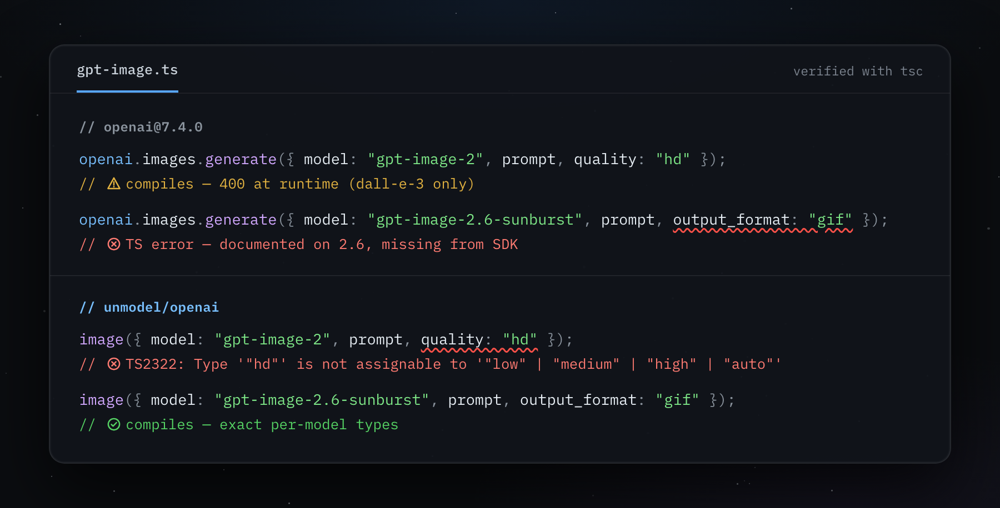

<h1 align="center">unmodel</h1>

<p align="center">
  Catalog-aware, type-safe validation and translation for AI API requests —<br>
  chat, speech, images, video, avatars, 3D, and music across 81 providers.<br>
  Bring your own SDK or <code>fetch</code>. Your keys never touch it.
</p>

<p align="center">
  <a href="https://www.npmjs.com/package/unmodel"></a>
  <a href="https://github.com/cluely/unmodel/actions/workflows/ci.yml"></a>
  
  =20">
  <a href="LICENSE"></a>
</p>

<p align="center">
  
</p>

unmodel checks your request against what the provider actually accepts before it leaves the process, compiles optional cross-provider params to real wire bodies, and checks raw responses for truncation, refusals, usage, and catalog-priced cost. It never sends a request and never sees a credential.

```sh
npm install unmodel
# or: bun add unmodel
```

Every ❌/✅ in this README is verified by `tsc` and backed by tests ([test/docs/readme.test.ts](test/docs/readme.test.ts)) — including the hero above against `openai@7.4.0`:

```ts
// openai@7.4.0 — one flat union for every image model, wrong in both directions
openai.images.generate({ model: "gpt-image-2", prompt, quality: "hd" });
// ⚠️ compiles — 400 at runtime (dall-e-3 only)
openai.images.generate({ model: "gpt-image-2.6-sunburst", prompt, output_format: "gif" });
// ❌ TS error — documented on 2.6, missing from SDK

// unmodel/openai — exact per-model types
import { image } from "unmodel/openai";

image({ model: "gpt-image-2", prompt, quality: "hd" });
// ❌ TS2322: Type '"hd"' is not assignable to '"low" | "medium" | "high" | "auto"'
image({ model: "gpt-image-2.6-sunburst", prompt, output_format: "gif" });
// ✅ compiles — exact per-model types
```

---

## Quick start

Validate a request, send the wire body with your own `fetch` and auth header, and inspect the raw response:

```ts
import { toRequestInit } from "unmodel";
import { chat } from "unmodel/chat";
import { checkChat } from "unmodel/openai";

const request = chat({
  model: "openai/gpt-5.2",
  messages: [{ role: "user", content: "Explain this code in one sentence." }],
  maxOutputTokens: 256,
});

JSON.stringify(request);
// → {"model":"gpt-5.2","messages":[...],"max_completion_tokens":256}

const { url, ...init } = toRequestInit(request);
const response = await fetch(url, {
  ...init,
  headers: {
    ...init.headers,
    authorization: `Bearer ${process.env.OPENAI_API_KEY ?? ""}`,
  },
});

const report = checkChat(await response.json());
report.finishReason; // "stop", "length", ...
report.costUSD;      // actual catalog-priced usage, when available
```

The validated result *is* the exact wire body; `toRequestInit` packs URL, method, and static headers (`content-type`, `anthropic-version`, …) while auth stays yours.

---

## Architecture: two layers, zero lock-in

unmodel is built in two layers, and they are not peers:

```text
canonical params → provider wire params → provider validator → fetch or SDK
   (unified)            (compile)          (the substrate)       (yours)
```

Every unified call compiles down to provider-native wire fields and finishes inside that provider's own validator. There is no second definition of valid: if a unified vocabulary cannot express a provider feature, it gives you a typed refusal or `providerOptions.<id>` — and the wire-exact subpath is always one import away.

| Need | Import | Input |
| --- | --- | --- |
| Portable across providers | `unmodel/chat`, `unmodel/image`, `unmodel/video`, `unmodel/tts`, … | camelCase params + `"provider/model"` |
| Exact provider wire API | `unmodel/openai`, `unmodel/anthropic`, `unmodel/fal`, `unmodel/revana`, … | native fields + bare model id |
| Minimal custom bundle | `createChat` from `unmodel/chat/factory`; `create*` from media entries | registers only the providers you call |
| Types with zero runtime | `unmodel/<provider>/types`, `unmodel/types` | emits no JavaScript at all |
| UI picker option lists | `unmodel/<provider>/values`, `unmodel/values` | ~1 KiB arrays, `===` what validators enforce |

- **Zero provider SDK dependencies** — only `zod` and `citty` at runtime; works on Node 20+, Bun, and Cloudflare Workers.
- **Catalog-backed** — generated [models.dev](https://models.dev) LLM metadata plus hand-cited media catalogs (pricing, limits, deprecations).
- **Budgeted imports** — bundle size, declaration weight, and TypeScript instantiation counts are asserted in CI.

---

## Surfaces

Fifteen unified surfaces cover chat plus fourteen media modalities, alongside wire-only surfaces where providers don't share a canonical shape. Unified refs split on the first slash (`openrouter/anthropic/claude-opus-5` → provider `openrouter`, model `anthropic/claude-opus-5`).

| Modality | Surface | Portable import | Ready providers | Provider-native examples |
| --- | --- | --- | --- | --- |
| **Chat** | [Chat](docs/surfaces.md#chat) | `unmodel/chat` | 33 | `unmodel/openai`, `unmodel/anthropic`, `unmodel/google` |
| **Image** | [Image generation](docs/surfaces.md#image-generation) | `unmodel/image` | 19 | `unmodel/openai`, `unmodel/black-forest-labs`, `unmodel/fal`, `unmodel/higgsfield` |
| | [Image editing](docs/surfaces.md#image-editing) | `unmodel/image-edit` | 9 | `unmodel/openai`, `unmodel/black-forest-labs`, `unmodel/photoroom`, `unmodel/stability` |
| | [Upscale](docs/surfaces.md#upscale) | `unmodel/upscale` | 3 | `unmodel/topaz`, `unmodel/fal`, `unmodel/revana` |
| **Video** | [Video generation](docs/surfaces.md#video-generation) | `unmodel/video` | 16 | `unmodel/openai`, `unmodel/kling`, `unmodel/bytedance`, `unmodel/higgsfield` |
| | [Lipsync](docs/surfaces.md#lipsync) | `unmodel/lipsync` | 5 | `unmodel/sync`, `unmodel/veed`, `unmodel/heygen`, `unmodel/fal` |
| | [Avatar](docs/surfaces.md#avatar) | `unmodel/avatar` | 5 | `unmodel/sync`, `unmodel/veed`, `unmodel/heygen`, `unmodel/fal` |
| **3D** | [3D generation](docs/surfaces.md#3d-generation) | `unmodel/3d` | 2 | `unmodel/tripo3d`, `unmodel/fal` |
| **Speech** | [Text to speech](docs/surfaces.md#text-to-speech) | `unmodel/tts` | 20 | `unmodel/openai`, `unmodel/elevenlabs`, `unmodel/cartesia`, `unmodel/deepgram` |
| | [Speech to text](docs/surfaces.md#speech-to-text) | `unmodel/stt` | 13 | `unmodel/openai`, `unmodel/deepgram`, `unmodel/assemblyai`, `unmodel/soniox` |
| | [Voice conversion](docs/surfaces.md#voice-conversion) | `unmodel/sts` | 2 | `unmodel/elevenlabs` |
| | [Voice cloning](docs/surfaces.md#voice-cloning) | `unmodel/voice-clone` | 6 | `unmodel/elevenlabs`, `unmodel/cartesia`, `unmodel/minimax` |
| | [Voice design](docs/surfaces.md#voice-design) | `unmodel/voice-design` | 4 | `unmodel/elevenlabs`, `unmodel/fish-audio`, `unmodel/inworld` |
| **Audio** | [Music generation](docs/surfaces.md#music-generation) | `unmodel/music` | 6 | `unmodel/elevenlabs`, `unmodel/google`, `unmodel/mureka`, `unmodel/stability` |
| | [Sound effects](docs/surfaces.md#sound-effects) | `unmodel/sfx` | 2 | `unmodel/elevenlabs`, `unmodel/fal` |
| **Wire-only** | [Realtime audio](docs/surfaces.md#realtime-audio) | — | 6 | `unmodel/openai`, `unmodel/deepgram`, `unmodel/elevenlabs`, `unmodel/cartesia` |
| | [Dubbing](docs/surfaces.md#dubbing) | — | 1 | `unmodel/elevenlabs` (`dub`, `dubLanguage`) |

### Same weights, four wire formats

One unified call targeting the same **Seedance 2.5** weights across ByteDance natively and three aggregators compiles to four completely different URLs and wire schemas — with zero warnings:

```ts
import { video } from "unmodel/video";

const base = { prompt: "rain over a neon alley", duration: 5, aspectRatio: "16:9" } as const;

// BytePlus ModelArk (native): nested content[], numeric duration, `ratio`
video({ model: "bytedance/dreamina-seedance-2-5-260628", ...base });
// → POST https://ark.ap-southeast.bytepluses.com/api/v3/contents/generations/tasks
//   {"model":"dreamina-seedance-2-5-260628","content":[{"type":"text","text":"rain over a neon alley"}],"duration":5,"ratio":"16:9"}

// fal.ai: endpoint moves into the URL, duration becomes a string, `aspect_ratio`
video({ model: "fal/bytedance/seedance-2.5/text-to-video", ...base });
// → POST https://queue.fal.run/bytedance/seedance-2.5/text-to-video
//   {"prompt":"rain over a neon alley","duration":"5","aspect_ratio":"16:9"}

// Revana: fields nest under `input`, numeric duration, `aspect_ratio`
video({ model: "revana/seedance-2.5", ...base });
// → POST https://api.revana.si/v1/generations
//   {"model":"seedance-2.5","input":{"prompt":"rain over a neon alley","duration":5,"aspect_ratio":"16:9"}}

// Atlas Cloud: task lives in `model`, flat body, numeric duration, `ratio`
video({ model: "atlascloud/bytedance/seedance-2.5/text-to-video", ...base });
// → POST https://api.atlascloud.ai/api/v1/model/generateVideo
//   {"model":"bytedance/seedance-2.5/text-to-video","prompt":"rain over a neon alley","duration":5,"ratio":"16:9"}
```

### Compile-time narrowing per model and route

Every surface — native or unified — narrows options, input shapes, and required fields to the exact model you pick:

```ts
import { chat } from "unmodel/anthropic";
import { image } from "unmodel/image";
import { video } from "unmodel/video";
import { stt } from "unmodel/stt";
import { sfx } from "unmodel/sfx";

// 1. Model-specific breaking API changes (Claude 4.7+ removed manual extended thinking)
chat({ model: "claude-opus-4-6", max_tokens: 4096, thinking: { type: "enabled", budget_tokens: 2048 }, messages }); // ✅
chat({ model: "claude-opus-5",   max_tokens: 4096, thinking: { type: "enabled", budget_tokens: 2048 }, messages });
// ❌ error TS2322: Type '"enabled"' is not assignable to type '"disabled" | "adaptive"'.

// 2. Unified resolution matrices & per-model limits
JSON.stringify(image({ model: "openai/gpt-image-2", prompt: "a lighthouse in fog", aspectRatio: "16:9", resolution: "1k" }));
// → {"model":"gpt-image-2","prompt":"a lighthouse in fog","size":"1360x768"}

video({ model: "openai/sora-2-pro", prompt: "…", resolution: "1080p", duration: 16 }); // ✅
video({ model: "openai/sora-2",     prompt: "…", resolution: "1080p" });               // ❌ TypeScript error (720p only)

// 3. Route input shapes — URL vs multipart Blob enforced at compile time
declare const url: string;
declare const file: Blob;

stt({ model: "assemblyai/universal-2", audio: { url } });  // ✅ AssemblyAI fetches a URL
stt({ model: "assemblyai/universal-2", audio: { file } }); // ❌ TypeScript error

stt({ model: "cartesia/ink-whisper", audio: { file } });   // ✅ Cartesia takes multipart bytes
stt({ model: "cartesia/ink-whisper", audio: { url } });    // ❌ TypeScript error

// 4. Per-model required fields & provider defaults
sfx({ model: "elevenlabs/eleven_text_to_sound_v2", prompt: "a door creaking open", durationSeconds: 4 }); // ✅
sfx({ model: "fal/sonilo/v1.1/text-to-sound-effects", prompt: "rain on a tin roof" });
// ✅ compiles, with warning: approximated_param — endpoint defaults to 8 seconds
sfx({ model: "fal/cassetteai/sound-effects-generator", prompt: "rain on a tin roof" });
// ❌ TypeScript error: `durationSeconds` is required here (the wire answers 422 without it)
```

Per-category guides, multipart helpers, and custom bundle packs: [docs/surfaces.md](docs/surfaces.md). Per-provider TTS auth and delivery quirks: [docs/tts.md](docs/tts.md).

---

## Validation, cost gates & response checks

### Pre-flight validation & cost gates

Invalid params throw `UnmodelValidationError` (check with `UnmodelValidationError.isInstance(err)` so it survives realm boundaries — and never retry it, since validation is pure). Use `.safe()` to get errors, warnings, and pre-send cost estimates as values, and `maxCostUSD` to block runaway spend before it leaves the process:

```ts
import { chat } from "unmodel/chat";
import { tts } from "unmodel/tts";

const result = chat.safe({
  model: "openai/gpt-5.2",
  messages: [{ role: "user", content: "Hello!" }],
});

if (result.ok) {
  result.params;   // validated provider body
  result.warnings; // non-fatal findings (deprecations, approximations, ...)
  result.estimate; // input tokens and worst-case cost, when known
} else {
  result.errors;
}

// maxCostUSD turns the estimate into a hard gate — over budget is an error, not a warning
const within = tts.safe(
  { model: "elevenlabs/eleven_multilingual_v2", text: "The lighthouse is ready.", voice: "21m00Tcm4TlvDq8ikWAM" },
  { maxCostUSD: 0.01 },
);
// within.ok === true, within.estimate.costUSD === 0.00192

const blocked = tts.safe(
  { model: "elevenlabs/eleven_multilingual_v2", text: "a".repeat(200), voice: "21m00Tcm4TlvDq8ikWAM" },
  { maxCostUSD: 0.01 },
);
// blocked.ok === false, blocked.errors[0].code === "over_budget"
```

What is checked:
- Schema shape, unknown fields, enums, and mutually exclusive parameters
- Model existence, deprecations, capabilities, and per-model API exceptions
- Context, input, output, media, and provider-specific limits
- Pre-send budget caps via `maxCostUSD`
- Unsupported or lossy unified translations (never dropped silently)

For untrusted JSON boundaries, unified surfaces expose `.safeUnknown(value)`. Severity overrides, future model IDs, and retry guidance: [docs/validation.md](docs/validation.md).

### Check responses

Provider `check*` helpers inspect raw response payloads and normalize quality, usage, and cost signals:

```ts
import { checkChat } from "unmodel/openai";

const payload = await response.json();
if (!response.ok) throw new Error(`Provider error ${response.status}`);

const report = checkChat(payload);
report.warnings;     // truncation, filtering, refusals
report.finishReason; // normalized finish reason
report.usage;        // input, output, cached, reasoning tokens
report.costUSD;      // actual cost from catalog rates
```

Media checkers match their response documents (`checkImages`, `checkTranscription`, `checkTts`, `checkGeneration`, `checkQueueStatus`, …) — see [docs/validation.md](docs/validation.md#check-responses).

---

## Retarget across hosts with `.toApi()`

Move a validated request to another host that serves the same model — with compile-time checking of which hosts actually serve it and explicit warnings whenever a dialect translation drops or respells anything.

### Chat

```ts
import { chat } from "unmodel/anthropic";

const request = chat({
  model: "claude-opus-5",
  max_tokens: 4096,
  thinking: { type: "adaptive" },
  messages: [{ role: "user", content: "Explain retargeting." }],
});

const moved = request.toApi("openrouter");
moved.model;       // "anthropic/claude-opus-5"
moved.request.url; // "https://openrouter.ai/api/v1/chat/completions"
moved.warnings;    // [id_respelled, dropped_param ("thinking")]

request.toApi("openai");
//            ~~~~~~~~ ❌ TypeScript error: OpenAI does not serve Claude
```

`CHAT_AUTH` from `unmodel/chat` maps each chat host to its auth header and scheme. `.toApiSafe()` is the non-throwing form; see [docs/validation.md](docs/validation.md#retarget-chat).

### Media (`native → fal`)

Six media provider families across image, video, and TTS can retarget directly onto fal's queue:

```ts
import { video } from "unmodel/kling";

const request = video({
  model_name: "kling-v2-5-turbo",
  prompt: "A slow push-in through a rainy neon alley",
  mode: "pro",
  duration: "10",
});

const onFal = request.toApi("fal");
onFal.request.url;     // "https://queue.fal.run/fal-ai/kling-video/v2.5-turbo/pro/text-to-video"
JSON.stringify(onFal); // '{"prompt":"A slow push-in…","negative_prompt":"","duration":"10"}'
onFal.warnings;        // [] ← empty means the mapping was exact

declare const fromConfig: string;
video({ model_name: fromConfig, prompt: "…" }).toApi("fal");
//                                             ~~~~~ ❌ TypeScript error: no verified fal mapping
```

A parameter fal cannot express is an error, never a silent drop. Remember that auth moves with the host (Kling uses `Authorization: Bearer …`, fal uses `Authorization: Key …`). Full mapping table and deliberate refusals: [docs/providers.md](docs/providers.md#media-retargeting--toapifal).

---

## Zero-runtime types & UI picker values

Already have a client, or building model pickers in a frontend? Import types with zero runtime cost, or pull the exact arrays the validators enforce (~1 KiB per import):

```ts
import type { ChatParams } from "unmodel/types";          // 0 bytes JS emitted
import type { VideoBody } from "unmodel/openai/types";    // 0 bytes JS emitted
import { TTS_MODEL_PARAMS } from "unmodel/openai/values"; // ~1 KiB runtime arrays

TTS_MODEL_PARAMS["gpt-4o-mini-tts"].voices;
// → the exact array (asserted by ===) that the validator enforces
```

Every provider publishes `unmodel/<provider>/types` (verified zero-JS against a real build), and every unified media provider publishes `unmodel/<provider>/values` so your `<select>` options and request validation can never drift. Full reference: [docs/types-and-values.md](docs/types-and-values.md).

---

## Bring your own transport, catalog & CLI

### Fetch, SDKs, multipart & WebSockets

```ts
import OpenAI from "openai";
import { chat } from "unmodel/openai";

const request = chat({ model: "gpt-5.2", messages: [{ role: "user", content: "Hello!" }] });
await new OpenAI().chat.completions.create(request.toSdk("openai"));
```

- **Fetch**: `toRequestInit(request)` for JSON endpoints; multipart results reject `toRequestInit` at compile time and direct you to `toFormData` / `sttToFormData` / `imageEditToFormData`.
- **Provider SDKs**: `.toSdk("openai" | "google" | "google-vertex" | "fal" | "ai-sdk" | …)` for typed handoff.
- **Vercel AI SDK**: `.toSdk("ai-sdk")`, plus `withJsonSchemaTools` from `unmodel/ai-sdk` for tool definitions.
- **WebSockets & webhooks**: realtime validators return a ready `wss://` URL or validated first-frame config; `verifyWebhook` from `unmodel/revana` verifies signed deliveries via WebCrypto.

### Catalog & CLI

```ts
import { getModel } from "unmodel/catalog";
import { models as elevenModels } from "unmodel/elevenlabs";

getModel("openai", "gpt-5.2")?.cost;           // models.dev LLM catalog
elevenModels["eleven_multilingual_v2"].cost;   // hand-maintained media catalog
```

```sh
npx unmodel models openai gpt-5.2
npx unmodel validate openai.chat request.json
npx unmodel validate unified.image image.json --max-cost 0.05
npx unmodel validate unified.stt transcription.json --json
```

`validate` exits non-zero on invalid params. Details: [docs/integrations.md](docs/integrations.md).

---

## Providers

**81 providers** (plus `createOpenAICompatible` for proxies and self-hosted endpoints). Every provider has a native subpath (`unmodel/<id>`) and zero-runtime types (`unmodel/<id>/types`); media providers also publish `unmodel/<id>/values` and `unmodel/<id>/unified`.

### Frontier & multi-surface

| Subpath | Surfaces |
| --- | --- |
| `unmodel/openai` | chat, image, image-edit, video (Sora), tts, stt, realtime |
| `unmodel/anthropic` | chat (`/v1/messages`) |
| `unmodel/google` | chat, image (Imagen), video (Veo), music (Lyria), tts, stt |
| `unmodel/xai` | chat, image, video (Grok Imagine) |
| `unmodel/alibaba` | chat, tts (Qwen3-TTS), video (Wan) |
| `unmodel/minimax` | chat, tts, voice-clone, voice-design, video (Hailuo / H3) |
| `unmodel/mistral` | chat, stt (Voxtral) |
| `unmodel/stepfun` | chat, tts (StepAudio) |
| `unmodel/cohere` | chat (v2 native) |

### Aggregators & routers

| Subpath | Surfaces & coverage |
| --- | --- |
| `unmodel/fal` | 186 curated endpoints across 11 media verbs (`image`, `imageEdit`, `video`, `lipsync`, `avatar`, `upscale`, `threeD`, `tts`, `stt`, `music`, `sfx`) |
| `unmodel/revana` | 237 models across 13 addresses (`chat`, `image`, `imageEdit`, `video`, `lipsync`, `avatar`, `upscale`, `tts`, `music`, `*Queue` webhooks, `verifyWebhook`) |
| `unmodel/higgsfield` | 24 image + 87 video routes (`image`, `imageEdit`, `video`, Soul / Cinema Studio / Genjutsu + hosted Seedance, Kling, Wan, Recraft, Ideogram, Soul ID training) |
| `unmodel/atlascloud` | 27 video models on one route (Seedance, Wan, Veo) |
| `unmodel/openrouter` | chat (400+ models) |
| `unmodel/vercel` | chat (Vercel AI Gateway) |
| `unmodel/huggingface` | chat (HF Inference Router) |

### Cloud & custom endpoint factories

Providers whose URL depends on your account, region, or deployment expose factories:

| Subpath | Factory | Surfaces |
| --- | --- | --- |
| `unmodel/amazon-bedrock` | `createAmazonBedrock({ region })` | chat (Converse) |
| `unmodel/azure` | `createAzure({ endpoint })` | chat, image & image-edit (MAI) |
| `unmodel/google-vertex` | `createGoogleVertex({ project, location })` | chat (Gemini) |
| `unmodel/cloudflare-workers-ai` | `createCloudflare(accountId)` | chat |
| `unmodel/openai-compatible` | `createOpenAICompatible({ ... })` | any OpenAI-compatible Chat Completions endpoint |

### Chat creators & inference hosts

OpenAI-compatible chat subpaths with each provider's base URL, catalog, and quirk checks:

| Group | Subpaths (`unmodel/<id>`) |
| --- | --- |
| **Model creators (10)** | `deepseek`, `inception`, `longcat`, `meta`, `moonshotai`, `nvidia`, `perplexity`, `sarvam`, `upstage`, `zhipuai` |
| **Inference hosts (11)** | `baseten`, `cerebras`, `deepinfra`, `fireworks-ai`, `friendli`, `groq`, `nebius`, `novita-ai`, `scaleway`, `siliconflow`, `togetherai` |

### Speech, voice & music

| Subpath | Surfaces | Subpath | Surfaces |
| --- | --- | --- | --- |
| `unmodel/elevenlabs` | tts, stt, music, sfx, sts, dubbing, voice-clone, voice-design, realtime | `unmodel/murf` | tts |
| `unmodel/deepgram` | tts, stt, realtime | `unmodel/resemble` | tts |
| `unmodel/cartesia` | tts, stt, voice-clone, realtime | `unmodel/rime` | tts |
| `unmodel/inworld` | tts, stt, voice-clone, voice-design, realtime | `unmodel/smallest-ai` | tts |
| `unmodel/fish-audio` | tts, voice-clone, voice-design | `unmodel/assemblyai` | stt |
| `unmodel/lmnt` | tts, voice-clone | `unmodel/gladia` | stt |
| `unmodel/speechify` | tts, voice-clone | `unmodel/revai` | stt |
| `unmodel/breezeblue` | tts | `unmodel/soniox` | stt, realtime |
| `unmodel/mureka` | music | `unmodel/speechmatics` | stt |
| `unmodel/hume` | tts, sts *(API retired 2026-11-13; deprecated)* | | |

### Image & video

| Subpath | Surfaces | Subpath | Surfaces |
| --- | --- | --- | --- |
| `unmodel/black-forest-labs` | image (FLUX.2 / 1.x), image-edit | `unmodel/luma` | image (Photon), image-edit, video (Ray) |
| `unmodel/bria` | image (Fibo), image-edit | `unmodel/pixverse` | video |
| `unmodel/bytedance` | image (Seedream), video (Seedance) | `unmodel/recraft` | image, image-edit |
| `unmodel/ideogram` | image (v3 / v4), image-edit | `unmodel/reve` | image, image-edit |
| `unmodel/kling` | image, video (v2.5 / v2.6 / v3 / 4.0) | `unmodel/runway` | image, video |
| `unmodel/krea` | image | `unmodel/stability` | image, image-edit, music (Stable Audio) |
| `unmodel/leonardo` | image | `unmodel/vidu` | image, video |
| `unmodel/lightricks` | video (LTX-2.5 / 2.3) | `unmodel/photoroom` | image-edit (edit, background removal) |

### Lipsync, avatar, upscale & 3D

| Subpath | Surfaces |
| --- | --- |
| `unmodel/heygen` | lipsync, avatar |
| `unmodel/sync` | lipsync, avatar |
| `unmodel/veed` | lipsync, avatar |
| `unmodel/topaz` | upscale |
| `unmodel/tripo3d` | 3d |

### Notes on multi-model routers (`fal`, `revana`, `higgsfield`)

All three are generated from committed upstream snapshots (`codegen:fal`, `codegen:revana`, `codegen:higgsfield`) with hand-maintained pricing and overlays, and route slightly differently from single-vendor APIs:

```ts
import { image as falImage } from "unmodel/fal";
import { videoQueue } from "unmodel/revana";
import { video as higgsfieldVideo } from "unmodel/higgsfield";

// fal.ai: `endpoint` IS the URL path (stripped from body); auth uses `Authorization: Key ${FAL_KEY}`
const onFal = falImage({ endpoint: "fal-ai/flux/dev", prompt: "a cat", image_size: "landscape_4_3" });
// → POST https://queue.fal.run/fal-ai/flux/dev
//   {"prompt":"a cat","image_size":"landscape_4_3"}

// Revana: single-route `{ model, input }` on `revana.video`, or fal-style queue + webhook on `*Queue`
const onRevana = videoQueue({ model: "veo-3.1", fal_webhook: "https://example.com/hook", prompt: "rain on glass", duration: 8 });
// → POST https://api.revana.si/v1/queue/revana/veo-3.1?fal_webhook=https%3A%2F%2Fexample.com%2Fhook
//   {"prompt":"rain on glass","duration":8}

// Higgsfield: `endpoint` is the URL path across `image`, `imageEdit`, and `video`
const onHiggsfield = higgsfieldVideo({ endpoint: "bytedance/seedance-2.5/text-to-video", prompt: "rain on glass", duration: 5 });
// → POST https://api.higgsfield.ai/bytedance/seedance-2.5/text-to-video
//   {"prompt":"rain on glass","duration":5}
```

Full roster, implementation tiers, deliberate exclusions, and roadmap: [docs/providers.md](docs/providers.md).

---

## Docs

- [Surfaces guide](docs/surfaces.md) — all fifteen unified surfaces + wire-only surfaces, examples, quirks, and custom packs
- [Validation, cost, retargeting & response checks](docs/validation.md)
- [Types-only and values reference](docs/types-and-values.md)
- [Integrations: fetch, SDKs, catalog & CLI](docs/integrations.md)
- [Provider roster and roadmap](docs/providers.md)
- [TTS integrator's matrix](docs/tts.md)
- [Architecture decisions](docs/decisions.md)

## Development

```sh
bun install
bun test
bun run check
bun run bench:types
bun run build
bun run lint:pkg
bun run codegen            # regenerate catalog from committed snapshot
bun run codegen:fal        # regenerate fal types/tables from committed snapshots
bun run codegen:revana     # regenerate revana types/tables from committed snapshot
bun run codegen:higgsfield # regenerate higgsfield types/tables from committed snapshots
```

## License

MIT
